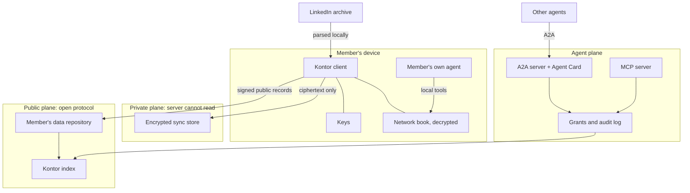

# RFC 0003: Architecture

- **Status:** Draft
- **Authors:** Ulrich Diedrichsen, Claude
- **Created:** 2026-11-11
- **Depends on:** RFC 0001, RFC 0002

## Summary

**Proposal.** Kontor is built from three planes with different trust models: a **public plane** on an open protocol, a **private plane** that the server cannot read, and an **agent plane** that exposes both under explicit grants. No single technology can serve all three, because an open social protocol is public by nature and a network book must not be.

## Problem

A professional network has two very different kinds of data:

- **Public and portable:** who I am, what I have done, what I am looking for. It should outlive any server.
- **Private and about others:** whom I know, what I think of them, how we met. It must never be public and should be unreadable to the operator.

Most designs treat these as one database with access rules. Then one bug, subpoena or change of ownership exposes the private half.

## Requirements

| Requirement | Source |
|---|---|
| A member can leave with everything, at any time | Principles on the site |
| The operator cannot read non-members' data | [RFC 0002](0002-linkedin-import.md) |
| Agents are first-class, declared and revocable | [RFC 0004](0004-agent-readiness.md) |
| Can be self-hosted | AGPL-3.0, principles |
| Affordable for a non-profit | Campaign target of €500 a month |
| Useful with one member | [RFC 0001](0001-complement-not-replacement.md) |

## Proposal

### Public plane

**Options.**

| | AT Protocol | ActivityPub | Own API with export |
|---|---|---|---|
| Account portability | Designed in: signed repositories and DIDs | Limited: redirects, previous data does not migrate (per AT Protocol's own FAQ, which is an interested source) | Only what we build |
| Custom data types | Lexicons | Extensions and conventions | Free |
| Existing professional schemas | `id.sifa.*`, MIT | h-resume conventions via ProFed | None |
| Private data | **Listed as missing;** the docs advise against bolting it on | Followers-only conventions, no end-to-end encryption | Whatever we build |
| Reach today | Bluesky network | Fediverse | None |
| Operating effort | PDS hosting, indexer | Server per community | Lowest |

**Proposal.** The AT Protocol for the public plane, with Kontor's own Lexicons for profiles, requests and offers. Reasons: portability is the promise we make, and it is the only option where portability is structural.

**Decision (Ulrich Diedrichsen, 2026-11-11):** Kontor stays independent of Sifa ([RFC 0001](0001-complement-not-replacement.md)). Nothing in the design may depend on Sifa's service, schemas or roadmap. Because `id.sifa.*` is MIT-licensed, reading or writing compatible records remains a possible interoperability feature.

This is the most consequential choice in this RFC and needs a spike before acceptance.

### Private plane

**Proposal.** Local-first and end-to-end encrypted.

- The network book, notes and tags live on the member's devices. The server stores only ciphertext for sync and recovery, and metadata is minimised.
- Search runs on the device.
- **What this costs:** no server-side search over the private plane, no server-side "people you may know", harder multi-device support, and key loss means data loss unless a recovery scheme is added. We accept the first two gladly, and the third and fourth need design work.

### Agent plane

Specified in [RFC 0004](0004-agent-readiness.md). The architectural requirement is that **every write from the first schema onward records who acted:** the principal, the acting party (human, agent or service) and the grant that allowed it.

### Identity

**Proposal.** Identity is a DID with a human-readable handle. A member can use their own domain. Kontor offers a handle for everyone else.

### Moderation

Open networks still need moderation. The AT Protocol's labeler model lets moderation decisions be published as metadata and chosen by the community. How that fits the association's rules needs its own RFC.

### Technology

The campaign site's stack (Cloudflare Workers and D1) was chosen for a small survey site and does not bind the network. Sifa's choice of Germany-based hosting and the promises made in the principles make **hosting jurisdiction** a design question, not a detail: see open question 3.

### Licensing

**Proposal.** Application code is AGPL-3.0-only, as today. Schemas and protocol documents use a permissive license so that others can adopt them without taking on the AGPL. **The repository is currently AGPL-3.0-only as a whole, so this requires an explicit change.**

## Alternatives considered

| Alternative | Why not |
|---|---|
| One server-side database with access control | The operator can read everything, which contradicts [RFC 0002](0002-linkedin-import.md) |
| Everything on a personal server per member | Too much to ask of most people; can remain an option for those who want it |
| Blockchain identity | Adds cost and permanence without solving a problem we have |
| Wait until the AT Protocol has private data | Timing unknown; the private plane is the reason Kontor exists |

## People affected who are not members

The private plane exists to protect them. See [RFC 0002](0002-linkedin-import.md).

## Abuse and threats

| Threat | Mitigation |
|---|---|
| Operator compromise or legal demand | Private plane is ciphertext; only the public plane and sync metadata can be disclosed |
| Lost device | Device-level protection, revocable device keys |
| Malicious client update exfiltrates keys | Reproducible builds, signed releases, open source. A web client remains weak here: open question 2 |
| Public plane is scraped | It is public by design. Members must understand that before publishing, as Sifa also states |
| Traffic analysis of the sync store | Minimise metadata; not fully solved |

## Agents

See [RFC 0004](0004-agent-readiness.md).

## Acceptance criteria

- A member can export everything and restore it on an independent instance.
- A database dump of the private plane contains no readable personal data, proven by test.
- Every stored action has principal, actor type and grant.
- A public profile remains retrievable after Kontor's own service is shut down.

## Open questions

1. Is the AT Protocol the right foundation given its public nature and governance? Its documentation describes a planned move to a formal standards process, not a finished one.
2. Can a browser client be trusted with end-to-end encryption when the server delivers its code? Does the first client need to be a native app?
3. Where is the network hosted? Does an EU-only infrastructure become a principle?
4. What key recovery scheme is acceptable for non-technical members?
5. How do multiple devices sync without a large amount of metadata?
6. Which encrypted-sync technology do we adopt rather than build? Needs research.

## Sources

- AT Protocol specification, including "What is Missing?": <https://atproto.com/specs/atp> (read 2026-11-11)
- AT Protocol FAQ on portability: <https://atproto.com/guides/faq> (read 2026-11-11)
- AT Protocol services and labelers: <https://atproto.com/guides/understanding-atproto> (read 2026-11-11)
- Sifa: <https://sifa.id/about> (read 2026-11-11)
- ProFed: <https://joinprofed.social/approach> (read 2026-11-11)
