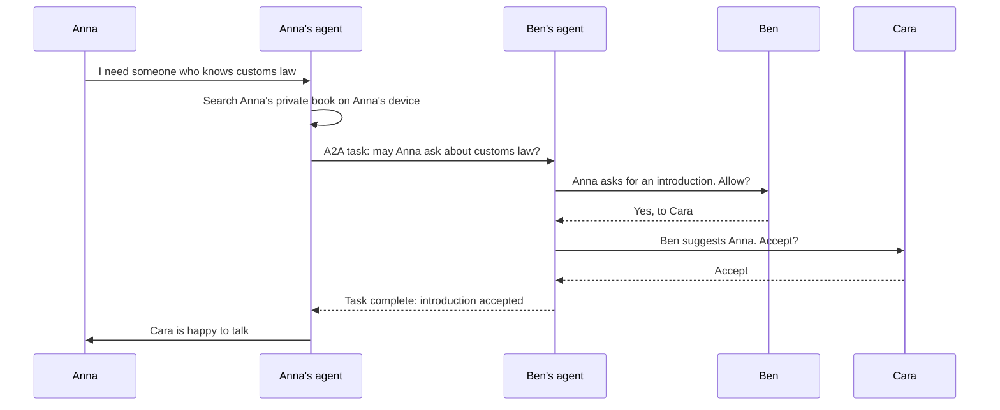

# RFC 0004: Agent readiness from day one

- **Status:** Draft
- **Authors:** Ulrich Diedrichsen, Claude
- **Created:** 2026-11-11
- **Depends on:** RFC 0001, RFC 0003

## Summary

**Decision (Ulrich Diedrichsen, 2026-11-11):** The network must be A2A-ready from day one.

**Proposal.** "Ready" means more than publishing an endpoint. Agents are a declared kind of actor in the data model from the first schema, always act for a named human under a revocable grant, and can never pose as people. The protocols are the easy part. The hard part is keeping a network of people from becoming a network of bots.

## Problem

People increasingly delegate tasks to software agents. A network without an interface for them will be scraped or impersonated instead. But the wishes people have voted on point the other way: `echte_menschen` asks that automatic comments and bots be removed. Both are legitimate, and this RFC has to reconcile them.

## Background

**Verified (read 2026-11-11).**

- **A2A (Agent2Agent)** is an open protocol for communication between opaque agents. Version 1.0.0 was released on 12 March 2026 and 1.0.1 in May 2026, and the wire version is `1.0`. Originally from Google, it moved to the Linux Foundation and became a project of the Agentic AI Foundation in August 2026. It is licensed Apache 2.0.
- An agent publishes an **Agent Card**, conventionally at `https://{domain}/.well-known/agent-card.json`, naming its skills, interfaces and security schemes. Cards may be signed with JWS after JCS canonicalisation. Sensitive detail belongs in an authenticated extended card.
- Bindings are JSON-RPC, gRPC and HTTP+JSON.
- The specification defines **no standard registry API**. Discovery is by well-known URI, curated catalogue or direct configuration.
- A2A explicitly **is not a messaging app** for people.
- **MCP** (revision 2026-07-28) connects one agent to tools and data. A2A connects agents to each other. They are complementary, and we need both.

## Proposal

### The three roles

| Role | Protocol | Example |
|---|---|---|
| **The network as an agent** | A2A server | "Find public offers for Rust consulting in Hamburg." |
| **A member's own agent** using their data | MCP, local tools | "Who do I know at this company?" |
| **Member agents talking to each other** | A2A | Negotiating an introduction |

### Rules

These are design constraints.

1. **Every agent has a human principal,** visible on every action. There are no free-standing agent accounts in the human network.
2. **An agent never poses as a human.** Agent-written content is labelled in the data, not just in the interface.
3. **Grants are explicit, narrow, time-limited and revocable,** and the member can see them all.
4. **Every agent action lands in an audit log** that the member can read.
5. **An agent cannot start contact with a human who has not agreed.** Cold outreach by agents is not possible, not merely forbidden.
6. **Consequential actions need human approval:** connecting, introducing, publishing, committing to anything.
7. **Private-plane data never passes through server-side agent interfaces.** It reaches only an agent the member runs or authorises on their own device.
8. **Everything read from the network is untrusted input.** Profile text may contain instructions aimed at an agent. Fields are returned as marked data, and our documentation tells agent authors so.
9. **Agents have budgets.** Requests and introductions are limited per principal, because agents remove the natural limit that human effort provides.

### Grants

A grant records principal, agent, scopes, expiry and whether human approval is required. Illustrative scopes:

| Scope | Allows | Approval |
|---|---|---|
| `public.read` | Read public profiles and requests | No |
| `requests.write` | Draft a request or offer | Publishing needs approval |
| `introductions.propose` | Ask for an introduction | Always |
| `availability.answer` | Answer others' agents about stated availability | Member sets the policy |

### Warm introductions

The feature that shows why this is worth doing:



No private data crosses a boundary without a person's approval, and the person being asked can always say no.

### Agent Card (illustrative)

Must be validated against `a2a.proto` before acceptance.

```json
{
  "name": "Kontor network agent",
  "description": "Search public professional profiles, requests and offers on Kontor.",
  "version": "0.1.0",
  "supportedInterfaces": [
    {
      "url": "https://kontor.example/a2a",
      "protocolBinding": "JSONRPC",
      "protocolVersion": "1.0"
    }
  ],
  "capabilities": { "streaming": false },
  "defaultInputModes": ["text/plain"],
  "defaultOutputModes": ["application/json"],
  "skills": [
    {
      "id": "requests.search",
      "name": "Search requests and offers",
      "description": "Find public requests and offers by topic and region.",
      "tags": ["professional", "network"],
      "examples": ["Find offers for Rust consulting in Hamburg"]
    }
  ]
}
```

The principal and grant travel in an A2A extension, which we would specify and publish.

### Conformance levels

| Level | Meaning | Available from |
|---|---|---|
| **L0** | Specs, roadmap and public results are machine-readable | Stage 0 |
| **L1** | Signed Agent Card, read-only public skills; member's own agent over MCP | Stage 1 |
| **L2** | Delegated writes under grants, audit log | Stage 2 |
| **L3** | Agent-to-agent negotiation with human approval | Stage 2 |

"Day one" therefore means: **L1 at first launch, and the actor and grant model in the first database schema,** so that nothing has to be retrofitted.

### Discovery of member agents

**Proposal.** A member may link an Agent Card from their public profile. Since most members will have no domain of their own, Kontor can host a card at a per-member path. Because no standard registry exists, the directory is opt-in and not enumerable in bulk.

## Alternatives considered

| Alternative | Why not |
|---|---|
| MCP only | Serves a member's own agent, but not agents of different people |
| A2A only | A member's own assistant needs tools and data, which is MCP's job |
| Agents as ordinary accounts | Makes them indistinguishable from people |
| Ban agents | Unenforceable, and it gives up the opportunity |
| A proprietary agent API | Contradicts the commitment to open protocols |

## People affected who are not members

Agents have no access to anyone who is not a member, and private-plane data never reaches server-side agent interfaces (rule 7).

## Abuse and threats

| Threat | Mitigation |
|---|---|
| Agent spam at scale | Budgets, rule 5, reputation attached to the human principal |
| Prompt injection through profiles and requests | Rule 8, human approval for consequences |
| Compromised agent drains a member's data | Narrow scopes, expiry, audit log, device-only private data |
| Bulk harvesting via search skills | Rate limits, no enumeration, pagination limits |
| Spoofed Agent Card | Signed cards, verified domains |
| Member blames "their agent" for harassment | The principal is accountable for their agents |
| Agent impersonates a member's approval | Approval is a signed action from the member's device |

## Acceptance criteria

- A conformance test validates the Agent Card against the A2A 1.0 schema.
- It is impossible to store an agent-originated action without a principal and a grant.
- A test shows an agent cannot contact a member who has not agreed.
- A revoked grant stops working immediately.
- The audit log shows every agent action to its principal.

## Open questions

1. Are A2A's task and security models sufficient for delegated authority, or does delegation need more than an extension?
2. How is agent-generated content labelled in a way that survives copying to other apps?
3. Which identity binds an agent to its principal: a DID key, a signed delegation, or something else?
4. Where do personal agents run for members who have none of their own? Would Kontor host them, and at what cost and privacy risk?
5. How does "no AI training on personal data" apply to third-party agents that read public profiles?
6. Does the public wish `echte_menschen` need rewording so that declared agents are clearly distinct from the bots it rejects?

## Sources

- A2A overview and governance: <https://a2a-protocol.org/> (read 2026-11-11)
- A2A specification: <https://github.com/a2aproject/A2A/blob/main/docs/specification.md> (read 2026-11-11)
- A2A discovery: <https://a2a-protocol.org/latest/topics/agent-discovery> (read 2026-11-11)
- Joining the Agentic AI Foundation: <https://a2a-protocol.org/latest/blog/2026/08/27/a-new-chapter-for-a2a-joining-the-agentic-ai-foundation/> (read 2026-11-11)
- Versions and registry status: <https://agent2agent.info/docs/faq/> (read 2026-11-11)
- A2A and MCP compared: <https://www.agentcard.net/blog/a2a-vs-mcp> (read 2026-11-11)
